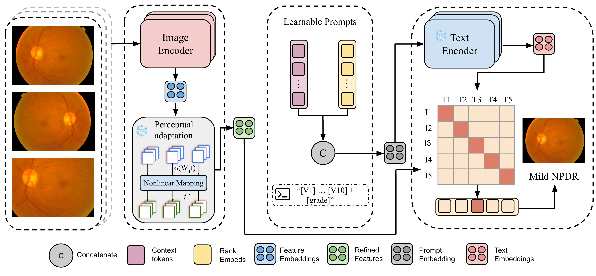
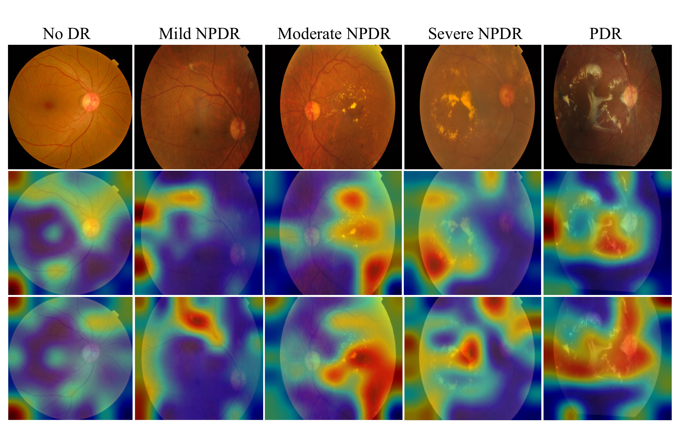

# VLM-DR: A Domain-Generalizable Vision-Language Model for Diabetic Retinopathy Grading



VLM-DR grades fundus images into the five ICDR grades (No DR, mild, moderate, severe NPDR, PDR) by comparing each image with learnable text prompts of the grades in the CLIP embedding space. It is trained with a cross-modal correlation alignment (CORAL) loss, a text-to-image KL loss and an ordinal rank loss. The implementation builds on the public code of [CLIP-DR](https://github.com/Qinkaiyu/CLIP-DR) and [OrdinalCLIP](https://github.com/xk-huang/OrdinalCLIP).

## Installation
```bash
git clone https://github.com/DoaaDalaq/VLM-DR.git
cd VLM-DR
pip install -r requirements.txt
git clone https://github.com/xk-huang/OrdinalCLIP.git
export PYTHONPATH=$PYTHONPATH:$(pwd)/OrdinalCLIP
```

## Data
Images are not included. Download APTOS, DeepDR, IDRiD, Messidor-2, RLDR and FGADR following the [GDRBench](https://github.com/chehx/DGDR) benchmark and place them under `images/` (e.g. `images/APTOS/...`).

- `splits/dg/`: domain generalization splits (GDRBench). `X_train.txt` is used for training and `X_crossval.txt` for validation when `X` is a source domain; `X_crossval.txt` is the test set when `X` is the target. FGADR is used only as a source domain.
- `splits/within/`: our within-domain splits (random, image level, 80/10/10).

Build the leave-one-domain-out files for a target domain:
```bash
bash make_dg_splits.sh APTOS      # or DEEPDR, IDRID, MESSIDOR, RLDR
```

## Training (leave-one-domain-out)
Each target domain is initialized from the corresponding CLIP-DR checkpoint (see the CLIP-DR repository), placed in `checkpoints/clipdr/`.
```bash
T=APTOS
python run_train.py -c configs/VLM-DR.yaml --output_dir results/$T \
  --cfg_options runner_cfg.load_weights_cfg.init_model_weights=checkpoints/clipdr/$T.ckpt \
  data_cfg.train_data_file=splits/train_no$T.txt data_cfg.val_data_file=splits/val_no$T.txt \
  data_cfg.test_data_file=splits/test_$T.txt
```
The checkpoint with the highest AUC on the source-domain validation split is kept. Main settings (see `configs/VLM-DR.yaml`): AdamW, 31 epochs, batch size 64, learning rate 1e-5 (image encoder) and 1e-4 (prompts), 1e-8 for the text encoder and temperature (practically frozen), equal loss weights, seed 42.

## Testing
```bash
CKPT=checkpoints/VLM-DR_$T.ckpt python run_test.py -c configs/VLM-DR.yaml --test_only --output_dir results/test_$T \
  --cfg_options data_cfg.train_data_file=splits/train_no$T.txt data_cfg.val_data_file=splits/val_no$T.txt \
  data_cfg.test_data_file=splits/test_$T.txt
```

## Checkpoints
The trained VLM-DR checkpoints for the five target domains are available in the [v1.0 release](https://github.com/DoaaDalaq/VLM-DR/releases/tag/v1.0).

## Ablations
Add to `--cfg_options`:
- without the projection: `runner_cfg.model_cfg.use_mlp=false`
- without CORAL: `runner_cfg.coral_weight=0`
- image-only classifier: `runner_cfg.model_cfg.type=ImageOnlyRN50`
- static prompts: `runner_cfg.model_cfg.prompt_learner_cfg.init_context="a fundus image with"` `runner_cfg.model_cfg.prompt_learner_cfg.init_rank_path=<file with the five grade names>` `runner_cfg.optimizer_and_scheduler_cfg.param_dict_cfg.lr_prompt_learner_context=0` `runner_cfg.optimizer_and_scheduler_cfg.param_dict_cfg.lr_prompt_learner_ranks=0`

## Qualitative results


## License
MIT (see `LICENSE`). Parts of the code are adapted from CLIP-DR and OrdinalCLIP; please also respect their licenses.
